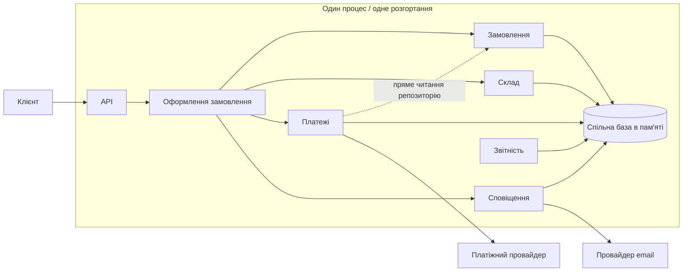
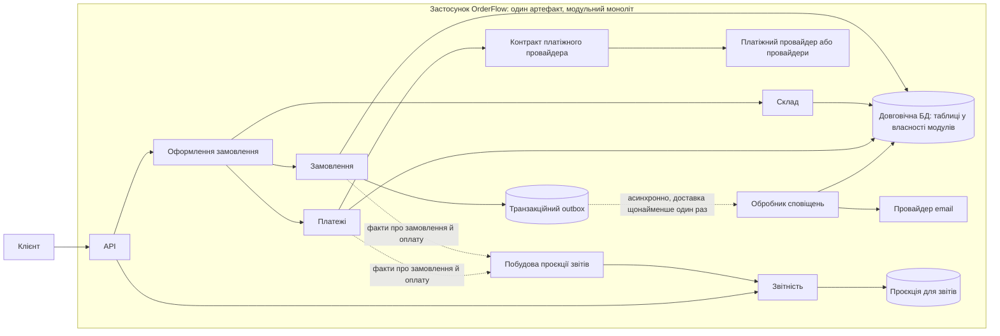

# OrderFlow: рішення щодо еволюції архітектури

## Підсумок рішення

**Проблема.** Доставка змін ускладнюється, але наявних доказів недостатньо, щоб замінити модульний моноліт п'ятьма сервісами. Найочевидніший зайвий зв'язок — Payments читає дані Orders через `OrderRepository`. Notifications також входить до критичного шляху оформлення замовлення, хоча email не потрібен для завершення продажу. У `CheckoutService` помилка email потрапляє до того самого обробника, що й помилка платежу: через це вже оплачене замовлення може стати невдалим, а зарезервований товар — повернутися до залишків. Reporting сканує робочі колекції в тому самому процесі, тому вартість звітів залежить від даних і навантаження оформлення замовлень.

**Докази.** За шість місяців Change Lead Time зріс із 2 до 6 днів, Modules Changed per Feature — з 1,7 до 4,3, Average PR Size — зі 180 до 520 LOC, Rollback Rate — з 2% до 9%, а кількість інцидентів — з 1 до 5 на місяць. У 48% змін функцій одночасно змінювалися Orders і Payments; 37% змін шаблонів сповіщень вимагали регресійного тестування оформлення замовлення. Два останні інциденти збіглися зі стрибками затримки платіжного провайдера. Це кореляції, а не доказ того, що причиною кожної зміни стала саме архітектура.

**Рішення.** Поки що залишити модульний моноліт і єдину межу розгортання. Уточнити API модулів і володіння даними; прибрати прямий доступ Payments до репозиторію Orders; оформити інтеграцію з платіжним провайдером як явний адаптер і контракт. Під час завершення замовлення надійно записувати намір надіслати сповіщення до transactional outbox, а email надсилати асинхронно з повторами та ідемпотентністю. Це також не дозволить помилці email запускати компенсацію платежу чи резерву після успішної оплати. Перенести читання для звітів за власну проєкцію Reporting, спочатку залишивши її в тому самому застосунку. Шаблони та експерименти сповіщень винести у версійну конфігурацію та feature flags, щоб більшості маркетингових змін не вимагали змін коду. На цьому етапі не виділяти окремі сервіси.

**Компроміси.** Оформлення замовлення більше не чекає на email, але підтвердження надходитиме із затримкою; потрібні повторні спроби, дедуплікація та операційний моніторинг. Проєкція звітів може відставати на кілька хвилин і потребуватиме додаткового сховища та обслуговування. Явні контракти зменшують випадкові залежності, але додають код і тести. Єдиний артефакт і надалі означає широкі розгортання та спільні домени відмов. Це свідомо прийнятна ціна для команди з вісьмома інженерами без окремої platform-команди.

**Як вимірюватимемо успіх.** Використовуватимемо базові значення й цілі з розділу [Метрики та архітектурні перевірки](#метрики-та-архітектурні-перевірки), переглянемо результати через два квартали та переглянемо рішення, якщо цілі не буде досягнуто або настануть умови для виділення сервісу.

## Поточна архітектура

Оформлення замовлення очікує на відповідь платіжного провайдера, а потім — на надсилання email. `ReportingService` безпосередньо сканує дані Orders, Payments, Notifications і Products. Спільне сховище в пам'яті означає, що межі модулів не є межами володіння даними. Перш ніж вважати асинхронний процес або майбутнє виділення сервісу надійними для production, потрібно забезпечити довговічність даних і узгодженість між кількома екземплярами.

## Запропонована архітектура та план еволюції

Діаграма показує цільові межі, але не означає, що поточна база в пам'яті вже підтримує довговічні транзакції. Спершу потрібно перейти на довговічне транзакційне сховище й додати transactional outbox (або еквівалентну довговічну чергу з гарантовано атомарною передачею). На початковому етапі обробник і проєкцію залишити в тому самому розгортанні застосунку. Не повертати успішну відповідь про завершення замовлення, доки стан замовлення та намір надіслати сповіщення не буде збережено разом. Споживачі мають витримувати повторну доставку. За поточного контракту оплата лишається синхронною. Перш ніж підключати провайдера з асинхронним підтвердженням, треба визначити явний стан `PENDING`, автентифікацію зворотних викликів, звіряння платежів і бізнес-правило щодо резерву товару.

### Межі, які слід зберегти, змінити або відкласти

| Межа | Рішення та обґрунтування |
| --- | --- |
| Координація Checkout з Orders, Inventory і Payments | Залишити синхронні виклики в межах процесу та одне розгортання. Резервування, оплата й перехід стану замовлення потребують узгодженості; мережеві виклики зараз додадуть часткові відмови й операційне навантаження без доказів потреби в незалежних командах. Зберегти ідемпотентність Inventory (`reserve:<orderId>`, `release:<orderId>`) і посилити її довговічними обмеженнями унікальності та транзакціями. |
| Payments → Orders | Змінити зараз. `PaymentService` отримує `OrderRepository` і безпосередньо читає суму й валюту замовлення. Checkout/Orders мають передавати мінімальну незмінну команду платежу: ID замовлення, суму, валюту й ключ ідемпотентності. Payments володіє записами платежів і не читає репозиторії інших модулів. Контракт визначити до підключення другого провайдера. |
| Платіжний провайдер | Залишити за межею Payments, але формалізувати порт провайдера й уніфікувати помилки та тайм-аути. Не додавати автоматичне перемикання на резервного провайдера, доки не узгоджені можливості провайдерів, ідемпотентність, звіряння платежів і контракт другого провайдера. |
| Notifications | Змінити критичний шлях, але не обов'язково межу розгортання. Надійно зберігати намір надіслати сповіщення та надсилати його асинхронно; шаблони й сегменти керувати як версійованою конфігурацією під час виконання. Потрібні повторні спроби, видимість черги невдалих повідомлень, дедуплікація та ручний повторний запуск. |
| Reporting | Припинити прямі запити до робочих колекцій. Побудувати власну проєкцію для читання на основі зафіксованих фактів про замовлення й оплату. Для більшості звітів припустиме відставання на кілька хвилин. Перш ніж виділяти базу чи сервіс, виміряти час відповіді та відставання проєкції. |
| Inventory | Залишити модулем моноліту. Повторні операції вже захищені в пам'яті, але ця гарантія не охоплює конкурентні запити й перезапуск процесу. У довговічному сховищі ідемпотентність резервування та зміну залишків потрібно виконувати атомарно. |
| Усі модулі як окремі сервіси | Поки що відкласти й не приймати цю пропозицію. Для команди з вісьмома інженерами без platform-команди це додасть мережеву взаємодію, окремі розгортання, чергування, безпеку, спостережуваність і складність узгодження даних. Повернутися до цього, лише якщо буде виміряна потреба в незалежному масштабуванні чи випуску, визначено відповідальних і забезпечено операційну готовність. |

Якщо пізніше виділення сервісу буде виправдане, **першим кандидатом є Reporting**: його трафік уже зріс приблизно втричі й може зрости у 8–10 разів, а затримка на кілька хвилин прийнятна. Виділяти його варто лише після незалежного формування проєкції, перевірки звіряння даних і підтвердження, що ресурси звітності помітно впливають на оформлення замовлень. Частота змін Notifications вища, але зовнішні шаблони й асинхронна доставка мають дешевше усунути значну частину залежності від випуску коду. Цей порядок слід переглянути, якщо після змін експерименти зі сповіщеннями й далі вимагатимуть частих розгортань застосунку.

### Сценарії та вимірювані результати

| Сценарій / стимул | Реакція та заторкнуті компоненти | Вимірювання |
| --- | --- | --- |
| A. 2–3 експерименти з шаблонами чи сегментацією на тиждень | Маркетинг оновлює версійовані шаблони й прапорці; обробник сповіщень використовує вибрану версію. Зміни лише шаблону не мають зачіпати Orders/Checkout. | Частка експериментів лише з шаблонами, що потребують випуску застосунку: ціль <10%; моніторити успішність доставки email і вік черги. |
| B. Регіональний провайдер з іншими помилками й асинхронним підтвердженням | Адаптер провайдера залишається в Payments. Не вмикати резервне перемикання, доки не перевірені контракт, автомат станів платежу, ідемпотентність, перевірка зворотних викликів і звіряння. | Код провайдера ізольований за межею Payments; частка повторних списань = 0; p95 часу від зворотного виклику до кінцевого стану відповідає погодженому SLO. |
| C. Трафік звітності зріс у 8–10 разів; затримка на кілька хвилин прийнятна | Масштабувати звіти окремо від операційних даних через проєкцію; виділяти Reporting лише за впливу на Checkout або неможливості виконати SLO в моноліті. | p95 звіту <2 с на репрезентативному навантаженні 10x; p95 відставання проєкції <5 хв; погіршення p95 Checkout не більш як на 5%. |
| D. Повторне резервування або звільнення резерву | Inventory атомарно записує ключ ідемпотентності разом зі зміною залишків; повторна команда повертає попередній результат. | Повторна команда не змінює залишки вдруге; інцидентів перевищення запасу = 0. |
| E. Затримка провайдера 2–3 секунди або його недоступність | Оплата залишається в критичному шляху, бо результат платежу визначає продаж. Застосовувати тайм-аут, обмежені повтори лише з ідемпотентністю та чіткі стани очікування/помилки. Email не входить до цього шляху. | Ціль p95 Checkout без часу провайдера <500 мс; окремо звітувати p95 і частку помилок платежів; після невдалої оплати не має залишатися завислого резерву. |
| F. Щомісячна знижка залежить від способу оплати й набору товарів | Розмістити правила ціноутворення та знижок у домені замовлення/оформлення, передати підсумкову суму в команді платежу, зберегти деталізацію ціни й опублікувати її для Reporting. | Показана клієнту, списана й відображена у звіті суми збігаються точно; зміна правила зачіпає не більш як 3 модулі й має цільові тести правил. |

## Пріоритети та принципи

### Архітектурні характеристики за пріоритетом

1. **Надійність і доступність оформлення замовлення.** Від нього залежить дохід; помилки платежу мають бути явними, резерв товару — не зависати й не допускати перевищення запасу. Email менш критичний і може затриматися.
2. **Модифікованість і час доставки змін.** Платежі й експерименти зі сповіщеннями часто змінюються; потрібно зменшити кількість змін між модулями й координаційне навантаження, не розділяючи кожен модуль на сервіс.
3. **Стійкість до відмов і діагностованість.** Затримки провайдера вже збігалися з інцидентами; потрібно ізолювати email, обмежити очікування провайдера та зробити повтори й переходи станів видимими.
4. **Масштабованість звітності.** Попит зростає, але припустима затримка в кілька хвилин дозволяє спершу використати проєкцію для читання, а незалежне масштабування розглянути пізніше.
5. **Можливість розгортання, а потім продуктивність.** Частіші й менші випуски корисні, але повністю незалежні розгортання наразі не виправдовують операційних витрат. Оптимізувати затримку Checkout там, де її виміряно; не жертвувати коректністю заради показника швидкодії.

Ми приймаємо затримку email, невелику застарілість звітів і подальше спільне розгортання всього застосунку, але не перевищення запасів, неправильні списання чи парк сервісів, який команда не спроможна підтримувати.

### Застосування принципів

- **Приховування інформації / явні контракти:** зараз порушені, бо Payments читає `OrderRepository`, а Reporting — спільні колекції. Замінити це командою платежу та контрактом фактів/проєкції; адаптер провайдера приховує специфічні для нього моделі.
- **Висока зв'язність усередині модуля / володіння:** Inventory уже відповідає за резервування, Payments інкапсулює виклики провайдера, але спільне сховище дозволяє кожному модулю переглядати чужі дані. Надати модулям власні таблиці й репозиторії, спершу залишивши спільну фізичну базу.
- **Напрямок залежностей:** Checkout може координувати API модулів; Payments не має залежати від сховища Orders. Reporting має споживати опубліковані факти, а не робочі репозиторії.
- **Компроміси / проєктування для змін:** не перетворювати кожну межу на мережеву. Локальний виклик — перевага, якщо важливі атомарність і простота підтримки малою командою. Ізолювати лише ті навантаження Notifications і Reporting, для яких є підтверджені окремі потреби.
- **Архітектурні перевірки:** автоматично й постійно перевіряти правила залежностей і поведінки, а не покладатися на те, що схема архітектури залишатиметься правдивою сама собою.

## Оцінка вартості змін

Приклад зміни: додати знижку для окремих способів оплати й наборів товарів, показати точну суму до списання та включити знижку у фінансові звіти. Оцінка в інженерних годинах охоплює координацію й тестування; це не фінансовий прогноз. Поточну оцінку обґрунтовують часті зміни між модулями й широкий обсяг регресійного тестування. Її слід перевірити на наступній порівнюваній функції.

| Показник | Поточна архітектура | Запропонована архітектура |
| --- | --- | --- |
| Заторкнуті модулі | 4: Checkout, Orders, Payments (через залежність від репозиторію), Reporting | 3: ціноутворення Checkout/Orders, контракт команди платежу Payments, проєкція Reporting |
| Інженерні години | ~72 год: реалізація 40, координація/перевірка 12, тести 20 | ~45 год: реалізація 27, координація/перевірка 6, тести 12 |
| Координаційні витрати | ~12 год; зміни між модулями й перевірка старшими інженерами | ~6 год; перевірка контракту й відповідальні за модулі |
| Обсяг тестування | Повна регресія Checkout і Reporting; синхронна помилка email може зірвати оформлення | Тести знижки й контракту платежу, контракту проєкції та звіряння, регресія Checkout; асинхронні тести сповіщень окремо |
| Обсяг розгортання | Увесь застосунок; спільний випуск і відкат для всіх модулів | І надалі весь застосунок; вужчий обсяг змін і тестів, але не незалежне розгортання |

За умовної ставки $50/год поточна оцінка становить 72 × $50 = $3 600, запропонована — 45 × $50 = $2 250; економія на цій зміні — $1 350. Це **не** означає, що архітектура вже зменшує радіус впливу розгортання. Експеримент лише з шаблоном слід оцінювати окремо: ціль — змінювати конфігурацію чи прапорець без випуску коду. Запропоноване покращення можна вважати успішним лише тоді, коли зіставні зміни підтвердять менші витрати без зростання кількості дефектів.

## Аналіз ризиків

Очікувана вартість ризику = імовірність події протягом **перших 12 місяців після впровадження** × оцінений бізнес-вплив події. Суми — приблизні оцінки вартості окремого інциденту (втрачений дохід, відновлення й підтримка), а не історична бухгалтерська звітність. Їх потрібно замінити фактичними даними про інциденти та дохід.

| Ризик | Імовірність | Бізнес-вплив | Очікувана вартість ризику | Пом'якшення |
| --- | ---: | ---: | ---: | --- |
| Помилка outbox або обробника затримує чи дублює email клієнту | 20% / рік | $10 000 / інцидент | $2 000 / рік | Транзакційний outbox; ідемпотентний споживач; повтори з паузою; сповіщення про вік черги й невдалі повідомлення; інструмент повторного запуску; тести аварійного перезапуску й повторної доставки. |
| Проєкція звітів застаріла або розходиться з операційними підсумками | 25% / рік | $20 000 / інцидент | $5 000 / рік | Версійовані факти; ідемпотентна проєкція; звіряння з джерелом; сповіщення про відставання (p95 <5 хв); можливість перебудувати проєкцію; не використовувати застарілі звіти для операційних рішень. |
| Міграція меж або даних порушує узгодженість Checkout чи коректність залишків | 15% / рік | $80 000 / інцидент | $12 000 / рік | Міграція за схемою expand-contract; атомарна зміна залишків і унікальний ключ ідемпотентності; тіньова перевірка та звіряння до перемикання; canary-випуск; план відкату; критерій переходу — нуль випадків перевищення запасу. |
| Зростання обсягу згенерованого коду збільшує дефекти під час перевірки й production-інциденти | 30% / рік | $30 000 / інцидент | $9 000 / рік | Людська перевірка змін фінансів і безпеки; походження згенерованого коду та тести; невеликі PR; відстеження дефектів і невдалих змін; обмеження паралельної роботи відповідно до спроможності QA і рецензентів. |

Найбільша очікувана вартість пов'язана з ризиком міграції та коректності, який створює наше ж рішення. Впроваджувати довговічне сховище й outbox поетапно та зупинитися, якщо не проходить звіряння або порушуються інваріанти Inventory. Оцінки ризиків можна переглядати; імовірність і вплив наразі не є виміряними фактами.

## Метрики та архітектурні перевірки

Щомісяця порівнювати результати з наведеними базовими значеннями. Не приписувати зміни лише архітектурі, якщо паралельно змінилися черги погодження чи тестування.

| Показник | Базове значення → ціль | Чому це важливо |
| --- | --- | --- |
| Modules Changed per Feature | 4,3 → <2,5 за 2 квартали | Безпосередньо відображає обсяг змін між модулями; порівнювати схожі типи функцій. |
| Change Lead Time | 6 днів → ≤3 днів за 2 квартали | Враховує повний час очікування, а не лише написання коду. Окремо відстежувати черги перевірки, інтеграції, валідації та випуску. |
| Rollback Rate | 9% → ≤4% за 2 квартали | Перевіряє, чи зменшують менші межі й цільові тести ризик, а не лише пришвидшують роботу. |
| Доступність і затримка Checkout | Визначити базове значення за перші 4 тижні; потім доступність ≥99,9%, p95 Checkout без провайдера <500 мс | Доступність впливає на дохід; вимірювати час застосунку окремо від часу провайдера. Наявні матеріали не містять базової доступності, тому це запропонований SLO, а не фактичне порівняння. |
| Доставка сповіщень і відставання проєкції | ≥99% повідомлень доставлено за 5 хв; p95 відставання проєкції звітів <5 хв | Перевіряє, що після вилучення сповіщень із синхронного шляху листи не губляться, а звіти не стають непридатними через застарілі дані. |

**Легкі архітектурні перевірки**

1. Автоматизований тест меж модулів: жоден файл у `src/payments/` не може імпортувати `src/orders/OrderRepository.js` або звертатися до колекції Orders; реалізації провайдерів доступні лише через порт Payments.
2. Контрактний тест Checkout: помилка чи затримка провайдера сповіщень не може зірвати успішне оформлення замовлення; намір надіслати сповіщення зберігається атомарно із завершенням, а повторна обробка завдання не створює логічних дублікатів.
3. Тест інваріанта Inventory: повтор тієї самої команди резервування чи звільнення, зокрема після симуляції перезапуску, змінює залишок лише один раз.

Провал такої перевірки вважати регресією архітектури. Виняток можливий лише із зазначенням відповідального, строку дії та бізнес-обґрунтування.

## ШІ та час виходу на ринок

Припущення зацікавлених сторін про прискорення у 4 рази стосується лише реалізації: скорочення реалізації з 40 до 10 днів не перетворює 120-денну доставку функції на 30 днів. Початкова модель додає тривалість етапів і приблизно трактує їх як робочі дні; на практиці частина етапів перетинається, тому прогноз потрібно звірити з фактичним розподілом часу виконання.

| Етап | Зараз | Плановий діапазон після цільових покращень | Що можна змінити / що лишається обмеженням |
| --- | ---: | ---: | --- |
| Аналіз | 20 днів | 17–18 днів | ШІ допомагає з дослідженням, прототипами й документацією (економія приблизно 2–3 дні); доступність зацікавлених сторін і фінансові рішення залежать від людей. |
| Реалізація | 40 днів | 15–20 днів | ШІ прискорює створення каркасу, тестів і типових змін. Діапазон навмисно перевищує найкращий сценарій у 10 днів, бо пропускна здатність перевірки, коректність і незнайома архітектура обмежують роботу. |
| Інтеграція | 25 днів | 18–20 днів | Явні контракти, менші PR і контрактні тести зменшують переробки; лишаються черга на спільне тестове середовище (3–5 днів) і перевірка взаємодії модулів. |
| Валідація | 25 днів | 16–20 днів | Автоматизація й друге тестове середовище дають змогу перевіряти паралельно; перевірки платежів і фінансів та обмежена спроможність QA залишаються. |
| Випуск | 10 днів | 6–7 днів | Менші випуски й частіші вікна допомагають; погодження production, моніторинг і готовність до відкату однаково потрібні. |
| **Разом** | **120 днів (~4 місяці)** | **72–85 днів (~3,3–3,9 робочого місяця)** | Розрахунок із 22 робочими днями на місяць; оцінка передбачає, що інвестиції вже зроблені, і не додає механічно всі найоптимістичніші заощадження. |

**Рекомендація:** для першої великої функції після необхідних інвестицій планувати 3–4 робочі місяці й уточнити прогноз за фактичними даними. За поточних обмежень місячний цикл не підтверджується: навіть реалізація за 10 днів залишає аналіз, інтеграцію, валідацію й випуск на час, що значно перевищує решту 12 робочих днів. Архітектура — лише частина обмежень: спільне розгортання, неявні контракти даних і широка регресія є архітектурними; очікування на зацікавлених сторін, одне тестове середовище, черга інтеграції на 3–5 днів, два вікна випуску на тиждень, залежність перевірки від двох старших інженерів і лише двоє фахівців QA — процесні та ресурсні обмеження.

Передумови: довговічні контракти модулів і цільові контрактні тести; автоматизована валідація, яку можна виконувати паралельно, і додаткове тестове середовище; невеликі PR, ротація рецензентів і поширення знань старших інженерів; швидші, але контрольовані випуски з canary та відкатом; узгоджені рішення продукту й фінансів; оцінювання впливу ШІ за результатами перевірки та дефектами. Це потребуватиме інвестицій і тимчасово може зменшити спроможність доставляти функції. Прискорення реалізації може натомість перенести чергу на перевірку, QA, інтеграцію чи випуск і збільшити ризик дефектів та переробок. Не слід винагороджувати кількість рядків коду або PR.

Щоб у майбутньому досягти місячного циклу, потрібна чітко обмежена велика функція, паралельний аналіз із прототипуванням, відсутність багатоденних черг на середовище й перевірку, переважно автоматизована валідація за ризиком і контрольований випуск щотижня або частіше. Після перших двох великих функцій порівняти фактичний час етапів, перцентилі черг, дефекти, що потрапили до production, частку невдалих змін, переробки й результати робіт із ШІ та без нього на порівнюваних завданнях. Якщо реалізація прискорилася, а загальний час — ні, вузьке місце перемістилося; якщо зросли дефекти чи переробки, потрібно зменшити темп або посилити валідацію. Повернутися до виділення сервісів, лише якщо Reporting помітно шкодить Checkout або потребує незалежного масштабування/випуску, чи якщо конфігурація Notifications і далі змушує випускати застосунок, — і тільки за наявності визначених операційних відповідальних.
